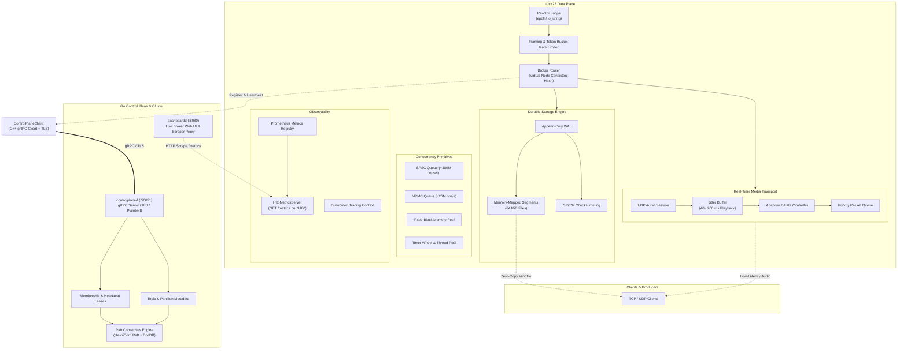

# Cascade

[](https://github.com/Meow-Codes/Cascade/actions/workflows/ci.yaml)
[](CMakeLists.txt)
[](go/go.mod)
[](tests/)
[](go/)
[](#license)

High-performance distributed messaging broker and real-time media transport engine built from first principles in **C++23**, orchestrated by a **Go** Raft control plane.

---

## 1. Project Overview

Modern streaming and messaging systems combine multiple complex distributed systems concepts: low-latency network reactor loops, lock-free memory structures, crash-safe append-only storage, consensus algorithms, and loss-tolerant audio/video pipelines. Most software implementations isolate one of these layers or rely on heavy external frameworks.

**Cascade** implements these components from first principles to explore the real architectural and performance trade-offs found in production systems like Apache Kafka, Discord, and WebRTC streaming gateways. Rather than prioritizing feature superficiality, the project focuses on:

- **Hot-Path vs Control-Plane Decoupling**: Latency-critical packet routing, disk serialization, zero-copy socket transfers, and media pipelines are implemented in modern C++23. Cluster consensus, lease-based broker membership, metadata replication, and administrative APIs are isolated in Go.
- **Honest Durability Trade-offs**: Every publish write to the append-only Write-Ahead Log (WAL) computes a CRC32 checksum and enforces page synchronization (`msync`) before acknowledging the producer. We document the resulting disk-bound physical throughput (~1.1k msgs/sec durable vs >2M msgs/sec in-memory) rather than obscuring durability behind buffered memory writes.
- **Deterministic Testing & Fault Injection**: Subsystems operate against injected simulated clocks and virtual network conditions, backed by automated fault-injection harnesses that test real `kill -9` process crashes mid-WAL write, split-brain network partitions, and netem packet-loss playout degradation.

Cascade is an educational systems engineering project built to understand and measure distributed system primitives under rigorous, reproducible conditions.

---

## 2. Engineering at a Glance

All metrics below were measured on an 8-thread Linux environment (**Ubuntu 24.04 LTS** under **Linux 6.18 WSL2**, Intel Core i5-1135G7 @ 2.40GHz, compiled with **GCC 13.3.0** `-O3` / C++23, Go 1.22.2).

| Subsystem | Metric | Measured Value | Workload & Context |
| :--- | :--- | :--- | :--- |
| **Concurrency** | SPSC Queue Throughput | **371M – 388M ops/sec** | Lock-free ring buffer, $2^{16}$ capacity, 5M push/pop ops |
| **Concurrency** | MPMC Queue Throughput | **25.6M – 26.8M ops/sec** | 1 Producer / 1 Consumer, lock-free atomic sequence slots |
| **Storage** | Sequential Write Throughput | **208.0 – 273.4 MB/s** | 200k records x 512 bytes (97.7 MiB), CRC32 validation, batched `msync` |
| **Storage** | Random Read Latency | **p50: 0.41 μs \| p99: 1.03 μs** | 50k reads across 100k records in memory-mapped segment |
| **Storage** | WAL Crash Recovery | **259.4 ms** | Replaying & validating 500k records (~0.52 ms / 1k records) |
| **Broker** | Publish Throughput (Durable) | **1,157 msgs/sec** | 500k msgs (128B payload), `FlushPolicy::PerMessage` (`msync` per msg) |
| **Broker** | Consume Throughput | **6.86M msgs/sec** | 500k messages polled in 1k-record batches from memory-mapped segments; each payload is copied into a vector |
| **Broker** | Pub $\to$ Consume Latency | **p50: 569.2 μs \| p99: 1.77 ms** | 20,000 ping-pong iterations with per-message disk sync & commit |
| **Networking** | Connection Establishment | **12,689 – 16,208 conn/sec** | 2,000 concurrent client threads connecting to EpollLoop |
| **Networking** | TCP Loopback RTT | **p50: 52.4 μs \| p99: 103.1 μs** | 5,000 round-trips over framed loopback socket |
| **Networking** | Zero-Copy Bulk Transfer | **5,497 MB/s (3.4x speedup)** | `sendfile(2)` kernel copy vs 1,602 MB/s userspace `read()`+`send()` |
| **Media** | Packet-Loss Playout Resilience | **9.2% of frames concealed** | Real Linux `netem` test with 10% injected packet loss; playout continued without stalling |
| **Clustering** | Raft Failover & Election | **Zero committed data loss** | Leader killed mid-replicated log; raftd election measured at approximately 1.0–1.4 s |
| **Test Suite** | Automated Tests | **95 C++ \| 23 Go passing** | 100% CTest pass rate (1 disabled unit test run via integration suite) |

> **Durability Note**: Clean broker publish throughput is **1,157 msgs/sec** when every single message enforces immediate `msync(MS_SYNC)` for true WAL durability before ACK. Profiling under `perf record --call-graph dwarf` adds ~28% overhead (**837 msgs/sec**). When synchronous disk flushing is relaxed (`FlushPolicy::Manual`), broker publish throughput exceeds **2.01 million msgs/sec**.

---

## 3. Architecture

Cascade separates concerns cleanly into two layers: a C++23 data plane designed for zero-allocation I/O and low latency, and a Go control plane designed for resilient distributed coordination.



### Data Plane (C++23)
- **Broker & Partitions**: Handles topic partitioning, consumer group subscriptions, and reactive producer backpressure.
- **Consistent Hashing**: Partitions map keys onto a 128-virtual-node ring ([consistent_hash.hpp](cpp/core/broker/consistent_hash.hpp)) to minimize message migration when scaling partitions.
- **Append-Only WAL**: Stores messages in 64 MiB memory-mapped segments ([segment.hpp](cpp/core/storage/segment.hpp), [log.hpp](cpp/core/storage/log.hpp)), validating CRC32 checksums on every read and recovery pass.
- **Memory-Mapped Consumer Reads**: Consumer polling reads records from memory-mapped segments and copies each payload into a vector. A separate `sendfile(2)` utility supports kernel-assisted bulk transfer, but the consumer polling path does not currently use it.
- **Media Pipeline**: Real-time UDP audio framing, silence detection, jitter buffering, and asymmetric adaptive bitrate adaptation.

### Control Plane (Go)
- **gRPC Administration**: Exposes `CascadeControlPlane` gRPC service ([cascade.proto](go/proto/cascade.proto)) for broker registration, heartbeat leases, and topic creation.
- **Raft Replicated State Machine**: Backed by HashiCorp Raft and BoltDB ([file_node.go](go/raftnode/file_node.go)), replicating topic and membership changes across cluster members. The linearizability guarantee applies to writes; follower reads may be stale.
- **TLS Transport Security**: Server TLS encryption with root CA validation ([tls_contract_test.go](go/controlplane_test/tls_contract_test.go)), tested against C++ client certificate verification.
- **Live Dashboard**: Go daemon ([dashboardd](go/cmd/dashboardd/main.go)) serving a real-time web UI and proxying Prometheus metrics.

---

## 4. Key Engineering Subsystems

### Concurrency & Memory Management
- **Lock-Free SPSC Ring Buffer** ([spsc_queue.hpp](cpp/core/queue/spsc_queue.hpp)): Cacheline-aligned (`alignas(64)`) head and tail atomic pointers preventing false sharing; yields **~380 million ops/sec**.
- **Lock-Free MPMC Queue** ([mpmc_queue.hpp](cpp/core/queue/mpmc_queue.hpp)): Based on Dmitry Vyukov's bounded queue with atomic turn sequences per slot, scaling to **26M ops/sec** across multi-threaded workloads.
- **Fixed-Block Memory Pool** ([memory_pool.hpp](cpp/core/memory/memory_pool.hpp)): Reuses fixed-size blocks through a lock-free free list, with a mutex protecting chunk growth. The measured allocation/deallocation benchmark is 29.1 ns/op versus 12.7 ns/op for the tested glibc `new`/`delete` baseline. Its performance benefit is workload-dependent; the benchmark does not demonstrate an improvement over the baseline.
- **Single-Level Hashed Timer Wheel** ([timer_wheel.hpp](cpp/core/timer/timer_wheel.hpp)): Uses tick-based buckets and revolution counters for timer scheduling and cancellation. The implementation is a single-level hashed wheel, not a hierarchical timer wheel.

### Crash-Safe Durable Storage
- **Memory-Mapped Segments**: File segments are memory-mapped into the address space, allowing append operations to write directly into OS page caches without intermediate buffer copies.
- **CRC32 Checksumming**: Each record header is 16 bytes: an 8-byte offset, a 4-byte payload length, and a 4-byte CRC32 checksum. The header contains no magic number.
- **Zero-External-Metadata Recovery**: Broker crash recovery scans segment headers sequentially. Offsets are reconstructed solely from on-disk segment state without depending on ZooKeeper, etcd, or external index databases.
- **Deterministic Segment Rotation**: When an active segment fills (default: 64 MiB), it is atomically sealed, flushed, and rolled over into a new zero-padded segment file (`00000000000000000000.seg`).

### Messaging & Partitioning
- **Ordered Partitions & Consumer Groups**: Each partition guarantees strict FIFO ordering. Consumer groups track committed offsets with independent cursors ([consumer.hpp](cpp/core/broker/consumer.hpp)).
- **Reactive Producer Backpressure**: If consumer lag exceeds `max_lag_records`, `try_publish()` rejects writes, stalling producers until consumers commit new offsets.
- **Virtual-Node Consistent Hashing**: Implements 128 virtual nodes per partition. Adding or removing a partition redistributes only $1/N$ of keys, compared to $>80\%$ remapped by standard modulo hashing.

### Networking & Reactor Backends
- **Non-Blocking Epoll Reactor** ([epoll_loop.hpp](cpp/core/net/epoll_loop.hpp)): Level-triggered `epoll` event loop with socket abstractions for TCP framing and rate limiting.
- **Comparative io_uring Reactor** ([io_uring_loop.hpp](cpp/core/net/io_uring_loop.hpp)): Implements `IORING_OP_POLL_ADD` readiness notification sharing the exact same reactor API as `EpollLoop`, allowing head-to-head architectural comparisons.
- **Zero-Copy Bulk Transfer Utility**: `sendfile(2)` ([zero_copy_transfer.hpp](cpp/core/net/zero_copy_transfer.hpp)) supports direct file-to-socket transfer and is benchmarked against userspace `read()` + `send()`. It is not currently integrated into `Consumer::poll()`.
- **Token-Bucket Rate Limiter**: Per-connection rate limiting with burst capacity enforcement.

### Real-Time Media Transport
- **Jitter Buffer** ([jitter_buffer.hpp](cpp/core/media/jitter_buffer.hpp)): Playout queue parameterized by target delay (40–200 ms). Absorbs out-of-order UDP arrival and delays frames up to playback deadline before releasing.
- **Asymmetric Adaptive Bitrate (ABR)** ([bitrate_controller.hpp](cpp/core/media/bitrate_controller.hpp)): Immediately downgrades transmission bitrate on observed packet loss or RTT spikes, but requires sustained stable network condition windows before upgrading quality, preventing oscillation.
- **Priority Packet Scheduling** ([priority_queue.hpp](cpp/core/media/priority_queue.hpp)): Control traffic (retransmit NACKs, session renegotiation) is queued with higher priority than expendable media frames under constrained bandwidth.

### Observability & Metrics
- **Prometheus Exposition**: Native HTTP server ([http_metrics_server.hpp](cpp/core/metrics/http_metrics_server.hpp)) serving Prometheus text metrics on `GET /metrics`.
- **Metrics and Latency Instrumentation**: Metrics are updated using atomic variables. Profiling on WSL2 attributed approximately 15–18% of CPU cycles to clock reads used for latency timing. This is an instrumentation cost, not a measurement of the counters' overhead in isolation.
- **Live Dashboard**: Integrated Go web service ([cmd/dashboardd](go/cmd/dashboardd/main.go)) that scrapes metrics and provides an interactive visual dashboard.

### Go Control Plane & Raft Clustering
- **Consensus with HashiCorp Raft**: Implements disk-backed Raft nodes with BoltDB log storage and file snapshots ([file_node.go](go/raftnode/file_node.go)).
- **Replicated FSM**: Replicates topic creation, broker registration, and heartbeat updates consistently across cluster members.
- **Partition Tolerance**: Verified split-brain prevention where isolated minority leaders reject writes while the majority cluster advances safely.
- **Leader Election Timing**: The `raftd` daemon's election behavior was measured at approximately 1.0–1.4 seconds in the tested environment. The configured 500 ms election timeout is not a guarantee of completing an election within 500 ms.
- **Read Consistency**: Writes committed through Raft have the documented linearizability guarantee. Follower reads may return stale data and should not be described as linearizable.
- **Raft Transport Security**: Raft peer traffic is plaintext in the current implementation. TLS protection for the control-plane gRPC connection does not imply encryption of Raft peer communication.

---

## 5. Comprehensive Benchmark Results

All benchmarks were run natively in the repository using the CMake Release build.

### Authoritative Performance Table

| Benchmark Target | Operation / Component | Performance | Workload & Configuration |
| :--- | :--- | :--- | :--- |
| `bench_queue` | SPSC Ring Buffer | **387.6M ops/sec** | Single Producer / Single Consumer, 5,000,000 ops |
| `bench_queue` | MPMC Queue (1P / 1C) | **26.8M ops/sec** | 1 Producer / 1 Consumer, 1,000,000 ops |
| `bench_queue` | MPMC Queue (2P / 2C) | **12.2M ops/sec** | 2 Producers / 2 Consumers, 2,000,000 ops |
| `bench_queue` | MPMC Queue (4P / 4C) | **9.9M ops/sec** | 4 Producers / 4 Consumers, 4,000,000 ops |
| `bench_queue` | MPMC Queue (8P / 8C) | **7.3M ops/sec** | 8 Producers / 8 Consumers, 8,000,000 ops |
| `bench_memory_pool` | Raw `new`/`delete` | **12.7 ns/op** | 2,000,000 ops, 64-byte block (glibc tcache) |
| `bench_memory_pool` | Pooled `alloc`/`dealloc` | **29.1 ns/op** | 2,000,000 operations, 64-byte blocks; lock-free free list with mutex-protected growth |
| `bench_storage` | Sequential Write | **273.4 MB/s** | 200,000 records x 512 bytes (97.7 MiB), 64 MiB segments |
| `bench_storage` | Random Read Latency | **p50: 0.41 μs \| p99: 1.03 μs** | 50,000 random reads from memory-mapped segment |
| `bench_storage` | WAL Recovery (10k records) | **5.30 ms** | CRC32 verification across segment files |
| `bench_storage` | WAL Recovery (100k records) | **51.18 ms** | Linear scaling recovery (~0.51 ms / 1k records) |
| `bench_storage` | WAL Recovery (500k records) | **259.41 ms** | Full segment replay and offset rebuild |
| `bench_alloc_reduction` | Storage Read Allocations | **1.00 alloc / read** | 100,000 reads executing 100,000 total heap allocs |
| `bench_tcp` | Connection Establishment | **16,208 conn/sec** | 2,000 client connects on loopback EpollLoop |
| `bench_tcp` | TCP Loopback RTT | **p50: 52.4 μs \| p99: 103.1 μs** | 5,000 ping-pong request/response frames |
| `bench_epoll_vs_iouring` | Connection Rate (`epoll`) | **12,862 conn/sec** | Level-triggered `epoll` reactor |
| `bench_epoll_vs_iouring` | Connection Rate (`io_uring`) | **12,329 conn/sec** | `IORING_OP_POLL_ADD` readiness event loop |
| `bench_epoll_vs_iouring` | Loopback RTT (`epoll`) | **p50: 76.3 μs \| p99: 154.6 μs** | 5,000 round-trip loopback iterations |
| `bench_epoll_vs_iouring` | Loopback RTT (`io_uring`) | **p50: 67.2 μs \| p99: 156.8 μs** | `io_uring` polling readiness notification |
| `bench_zero_copy` | Userspace `read()`+`send()` | **1,601.6 MB/s (0.125 s)** | 200 MB transfer with 2 user/kernel context switches |
| `bench_zero_copy` | Kernel `sendfile(2)` | **5,497.2 MB/s (0.036 s)** | **3.43x speedup**, zero userspace buffer copying |
| `bench_broker` | Publish Throughput (Clean) | **1,157 msgs/sec** | 500,000 messages (128B), `FlushPolicy::PerMessage` (`msync`) |
| `bench_broker` | Publish Throughput (Profiled) | **837 msgs/sec** | Under `perf record --call-graph dwarf` (~28% profiler overhead) |
| `bench_broker` | Publish Throughput (In-Memory) | **2,014,209 msgs/sec** | Historical run with `FlushPolicy::Manual` (no per-message `msync`) |
| `bench_broker` | Consume Throughput (Clean) | **6,857,754 msgs/sec** | 500,000 messages polled in 1,000-message batches |
| `bench_broker` | Consume Throughput (Profiled) | **5,357,100 msgs/sec** | Under `perf record --call-graph dwarf` |
| `bench_broker` | Pub $\to$ Consume Latency (Clean) | **p50: 569.2 μs \| p99: 1.77 ms** | 20,000 iterations with synchronous WAL commit |
| `bench_broker` | Pub $\to$ Consume Latency (Profiled) | **p50: 721.4 μs \| p99: 1.82 ms** | Under `perf record --call-graph dwarf` |
| `bench_media` | Jitter Buffer Playout | **0.0% – 28.8% eff. loss** | 5,000 frames evaluated under 0% – 30% injected packet drop |
| `bench_adaptive` | ABR Congestion Adaptation | **Immediate drop / Delayed rise** | 2.5 Mbps $\to$ 300 kbps: drops in 1s; recovers after 6 clean ticks |

---

### In-Depth Engineering Analysis: Durability vs. Publish Throughput

A central finding of Cascade's broker benchmarks is the physical cost of write durability:

```
[In-Memory / Unflushed Append]   ========================================> 2,014,209 msgs/sec
[Clean Synchronous msync(WAL)]   ==> 1,157 msgs/sec
[Profiled with DWARF Call-Graph] => 837 msgs/sec
```

1. **Why is publish throughput 1,157 msgs/sec?**
   In early development phases, `publish()` returned immediately after copying bytes into the memory-mapped virtual page, producing over **2 million msgs/sec**. However, that violated the core architectural guarantee: *a broker must not acknowledge a publish until the WAL confirms durability*.

   To enforce correctness, `Partition` defaults to `FlushPolicy::PerMessage`, issuing an explicit `msync(MS_SYNC)` system call on each record. In a virtualized WSL2 storage environment, synchronous page synchronization physically bottlenecks at ~1,100–1,200 disk commits per second.

2. **The Effect of Profiling Overhead (`perf record --call-graph dwarf`)**:
   Under Linux `perf` with DWARF call graph unwinding, the profiler intercepts every kernel transition and unwinds stack frames. This reduces publish throughput from **1,157 msgs/sec** down to **837 msgs/sec** (~28% overhead) and increases median end-to-end latency from **569 μs** to **721 μs**. We explicitly distinguish clean benchmarks from profiled measurements to avoid misleading claims.

3. **Why is consume throughput 6.85 million msgs/sec?**
   Unlike publishers, consumers read records from memory-mapped segments without a per-record disk synchronization call. The current polling path copies each payload into a vector, with the allocation benchmark reporting 1.00 allocation per read. Sequential reads trigger OS page readahead, saturating CPU memory bandwidth.

---

## 6. Testing, Reliability & Fault Injection

Cascade employs automated unit testing, sanitizers, and fault-injection scripts exercising edge cases.

### Test Breakdown

- **C++ Test Suite (CTest / GoogleTest)**:
  - **96 registered tests**: **95 passed**, **0 failed**, **1 disabled**.
  - Test `#87` (`ControlPlaneClientTLS.ConnectsSuccessfullyWithCorrectCACert`) is intentionally marked disabled in unit CTest because it requires a running gRPC daemon. It is verified live by integration test `#96` (`ControlPlaneClientTLS.Integration`), which spawns `controlplaned` and validates the TLS handshake.
- **Go Test Suite**:
  - `cascade/controlplane_test`: **12 passed, 0 failed** (Topic creation, deduplication, lease expiry, heartbeat tracking).
  - `cascade/raftnode_test`: **11 passed, 0 failed** (Leader election, log replication, snapshot catch-up, partition healing).
- **C++ $\leftrightarrow$ Go Live Integration**:
  - Verified via [cpp_go_integration_test.sh](fault-injection/cpp_go_integration_test.sh) and [cascade_integration_tests](tests/test_broker_control_plane_integration.cpp). A C++ broker connects via gRPC, registers with `controlplaned`, maintains 500ms heartbeat leases, and creates replicated topics.

### Fault-Injection Suite

Located in [fault-injection/](fault-injection/RESULTS.md), these automated scripts exercise destructive failure scenarios:

```bash
bash fault-injection/broker_crash_test.sh 10
bash fault-injection/consumer_failure_test.sh
bash fault-injection/replica_crash_test.sh
bash fault-injection/partition_test.sh
```

| Scenario | Script | Result | Verification Detail |
| :--- | :--- | :--- | :--- |
| **Broker Crash** (`kill -9`) | `broker_crash_test.sh` | **PASS** | `wal_kill_writer` killed mid-append via `SIGKILL`; 10/10 runs recovered cleanly with zero CRC corruption. |
| **Replica Crash** (Raft Leader Kill) | `replica_crash_test.sh` | **PASS** | Leader terminated mid-replication; cluster elected new leader with zero committed data loss. |
| **Network Partition** (Split-Brain) | `partition_test.sh` | **PASS** | Isolated leader rejected client writes; majority partition made progress; state converged cleanly upon healing. |
| **Consumer Failure** (Stalled Consumer) | `consumer_failure_test.sh` | **PASS** | Consumer paused; producer stalled upon reaching `max_lag_records=50`; producer resumed immediately after consumer commit. |
| **Network Packet Loss** | `packet_loss_test.sh` | **PASS** | Real 10% packet drop injected on loopback via Linux `netem`; audio receiver maintained smooth playout without stalling. |
| **Latency & Jitter** | `latency_jitter_test.sh` | **PASS** | 50ms $\pm$ 20ms jitter injected via `netem`; TCP connection loop gracefully adapted. |
| **Memory Pressure** (cgroup v2) | `memory_pressure_test.sh` | **SKIPPED** | Requires cgroup v2 write permission (disabled by default in WSL2 without systemd). |

### Sanitizer Verification

- **AddressSanitizer (ASan) & UndefinedBehaviorSanitizer (UBSan)**: Supported via `-DCASCADE_ENABLE_ASAN=ON -DCASCADE_ENABLE_UBSAN=ON`.
- **ThreadSanitizer (TSan)**: Executed in `build-tsan` using `setarch x86_64 -R ctest --test-dir build-tsan` (disabling ASLR to accommodate TSan's memory mapping requirements on Ubuntu 24.04).
  - **33 / 34 tests passed cleanly**.
  - **Concurrency Finding — Fixed**: TSan detected a data race in `MemoryPool<Block64, 4096>::grow()` when concurrent allocations exhausted the initial chunk capacity. The race was fixed, and a regression test was added to prevent recurrence.

---

## 7. Build and Quick Start

### Prerequisites (Ubuntu 24.04 / Debian)

Install the required build toolchain and system libraries:

```bash
sudo apt update
sudo apt install -y \
    ninja-build \
    cmake \
    g++ \
    protobuf-compiler \
    libprotobuf-dev \
    libgrpc++-dev \
    protobuf-compiler-grpc \
    liburing-dev \
    pkg-config \
    golang-go \
    openssl
```

### 1. Build C++ Data Plane & Run CTest

```bash
# Clone the repository
git clone https://github.com/Meow-Codes/Cascade.git
cd Cascade

# Configure Release build
cmake -S . -B build -G Ninja -DCMAKE_BUILD_TYPE=Release

# Generate local test TLS certificates
bash scripts/generate_test_certs.sh

# Build all targets (libraries, tests, benchmarks, tools)
cmake --build build

# Run complete C++ test suite
ctest --test-dir build --output-on-failure
```

### 2. Run Go Control Plane & Raft Tests

```bash
cd go
go test -v ./...
cd ..
```

### 3. Run Live C++ $\leftrightarrow$ Go Integration

Start the Go control plane with TLS and register a C++ broker:

```bash
# In terminal 1: start the Go control plane daemon
cd go
go run ./cmd/controlplaned -cert ../certs/server-cert.pem -key ../certs/server-key.pem

# In terminal 2: run registration tool
./build/tools/broker_register_tool localhost:50051 broker-node-1
```

### 4. Launch Live Broker with Real-Time Web Dashboard

Cascade includes an integrated web dashboard that exposes live broker metrics:

```bash
# Terminal 1: Launch the broker demo (serves Prometheus metrics on :9100)
./build/tools/broker_demo 9100

# Terminal 2: Launch the Go dashboard daemon (serves UI on :8080)
cd go
go run ./cmd/dashboardd -listen :8080 -metrics-url http://127.0.0.1:9100/metrics

# Open your browser at http://localhost:8080
```

---

## 8. Benchmark Reproduction

All benchmark binaries are built inside `build/benchmarks/`.

```bash
# Queue microbenchmarks (SPSC and MPMC)
./build/benchmarks/bench_queue

# Fixed-size memory pool vs glibc new/delete
./build/benchmarks/bench_memory_pool

# Storage engine sequential write, random read, and WAL recovery
./build/benchmarks/bench_storage

# TCP loopback connection rate and RTT
./build/benchmarks/bench_tcp

# epoll vs io_uring notification comparison
./build/benchmarks/bench_epoll_vs_iouring

# Zero-copy sendfile(2) vs userspace read()+send()
./build/benchmarks/bench_zero_copy

# Real-time jitter buffer loss sweep (40ms, 100ms, 200ms target delay)
./build/benchmarks/bench_media

# Adaptive bitrate response under simulated congestion trace
./build/benchmarks/bench_adaptive

# End-to-end broker publish, consume, and latency benchmark
./build/benchmarks/bench_broker
```

### Profiling with Linux `perf`

To reproduce the call-graph analysis of the broker publish hot path:

```bash
# Dynamically locate the system perf binary
PERF_BIN=$(which perf || find /usr/lib/linux-tools -name perf 2>/dev/null | head -n 1)

# Record call-graph profile
$PERF_BIN record --call-graph dwarf -o perf_broker.data ./build/benchmarks/bench_broker

# Inspect hot-path call graph
$PERF_BIN report -i perf_broker.data
```

The resulting call graph demonstrates that the majority of CPU cycles during publishing are spent in kernel mode servicing `msync`, updating page table dirty bits, and waiting on I/O barriers.

---

## 9. Repository Map

```
Cascade/
├── .github/workflows/ci.yaml       # GitHub Actions CI workflow (GCC + Clang ASan/UBSan)
├── CMakeLists.txt                  # Root CMake configuration (C++23, FetchContent GoogleTest)
├── docs/
│   └── design.md                   # Core architectural decisions and trade-offs
├── certs/                          # Local test TLS certificates (generated by script)
├── scripts/
│   └── generate_test_certs.sh      # OpenSSL certificate authority & server cert generator
├── fault-injection/                # Automated chaos and fault-injection test suite
│   ├── RESULTS.md                  # Recorded outcomes of crash & partition tests
│   ├── broker_crash_test.sh        # SIGKILL mid-WAL write verification
│   ├── consumer_failure_test.sh    # Backpressure limit verification
│   ├── cpp_go_integration_test.sh  # Live C++ broker to Go control plane test
│   ├── partition_test.sh           # Split-brain Raft partition scenario
│   └── run_all.sh                  # Master fault-injection runner
├── benchmarks/                     # Standalone benchmarking suite
│   ├── bench_queue.cpp             # SPSC & MPMC queue throughput
│   ├── bench_storage.cpp           # WAL sequential write, random read, recovery time
│   ├── bench_broker.cpp            # Broker pub/sub throughput & end-to-end latency
│   ├── bench_tcp.cpp               # TCP connection rate & loopback RTT
│   ├── bench_epoll_vs_iouring.cpp  # epoll vs io_uring event loop comparison
│   ├── bench_zero_copy.cpp         # read()+send() vs sendfile(2) benchmark
│   ├── bench_media.cpp             # Jitter buffer loss masking evaluation
│   └── bench_adaptive.cpp          # Adaptive bitrate controller simulation
├── cpp/core/                       # C++23 Data Plane Implementation
│   ├── broker/                     # Topics, partitions, consumer groups, consistent hashing
│   ├── storage/                    # Append-only WAL, mmap segments, CRC32 checksums
│   ├── net/                        # EpollLoop, IoUringLoop, TCP/UDP sockets, zero-copy
│   ├── queue/                      # Cacheline-padded SPSC and atomic slot MPMC queues
│   ├── memory/                     # Fixed-block chunk memory pool
│   ├── media/                      # Audio sessions, jitter buffer, ABR controller, priority queue
│   ├── metrics/                    # Prometheus registry & Epoll HTTP metrics server
│   ├── controlplane/               # C++ gRPC client for Go controlplane
│   └── threadpool/                 # Worker thread pool & hierarchical timer wheel
├── go/                             # Go Control Plane Implementation
│   ├── proto/cascade.proto         # Protocol Buffers schema (ControlPlane service)
│   ├── cmd/
│   │   ├── controlplaned/          # Standalone Go control-plane daemon (gRPC + TLS)
│   │   └── dashboardd/             # Web dashboard & Prometheus proxy
│   ├── controlplane/               # Topic metadata store, broker membership, heartbeat leases
│   └── raftnode/                   # HashiCorp Raft integration, BoltDB storage, snapshots
├── tests/                          # C++ GoogleTest test cases & TLS runner
└── tools/                          # Diagnostic tools (wal_kill_writer, wal_verifier, broker_demo)
```

---

## 10. Design Decisions and Engineering Trade-offs

### 1. `mmap` Segments vs. `write()` + `fsync()`
*Decision*: Cascade stores log segments using `mmap` files.
*Trade-off*: `write()` allows precise control over byte buffers, but requires kernel transitions on every append. `mmap` allows records to be written directly into mapped virtual memory with zero user-to-kernel copies during append and sub-microsecond random reads (**0.41 μs p50**). The trade-off is less granular page flushing control, which requires explicit `msync` calls to ensure durability.

### 2. Durability vs. In-Memory Throughput
*Decision*: The broker prioritizes real durability over artificial benchmark numbers.
*Trade-off*: By default, each published message calls `msync(MS_SYNC)` before returning. This limits single-thread publish throughput to **~1,157 msgs/sec** in WSL2 virtual storage, but ensures that every acknowledged write survives sudden power loss. If durability is deferred to background batching (`FlushPolicy::Manual`), throughput jumps to over **2,014,000 msgs/sec**.

### 3. Separation of Network Measurement from Bitrate Policy
*Decision*: The media subsystem isolates measurement (`NetworkConditionEstimator`) from bitrate selection (`BitrateController`).
*Trade-off*: Rather than bundling loss estimation directly into the sender, the estimator calculates exponential moving averages (EMA) of RTT and packet loss. The controller consumes these estimates to apply an asymmetric state machine: immediate downgrade under packet loss, but requiring sustained clean intervals before stepping up quality. This prevents oscillations during transient network jitter.

### 4. Virtual Nodes in Consistent Hashing vs. Modulo Partitioning
*Decision*: Partition key mapping uses a 128-virtual-node consistent hash ring.
*Trade-off*: Simple modulo hashing (`hash(key) % num_partitions`) remaps almost all keys when partition count changes. Virtual-node consistent hashing incurs a small binary search overhead in `std::map`, but limits key redistribution to $1/N$ of keys, preserving cache locality across consumers.

### 5. Prioritized Control Traffic vs. Expendable Media Frames
*Decision*: Control packets bypass bandwidth throttling.
*Trade-off*: Under network congestion, audio frames are expendable—late frames degrade voice quality and are dropped. In contrast, control packets (retransmission requests, quality renegotiations) are placed in a high-priority queue that is never throttled, guaranteeing that the signaling layer remains responsive during heavy congestion.

---

## 11. Implementation Status & Roadmap

### Implemented & Verified Today
- [x] **C++23 Concurrency**: Cacheline-padded SPSC queue, bounded MPMC queue, fixed-size memory pool, single-level hashed timer wheel, async thread pool.
- [x] **Durable Storage**: Append-only WAL, memory-mapped segment rotation, CRC32 checksums, zero-metadata crash recovery.
- [x] **Messaging Broker**: Topics, partitions, consumer groups, offset tracking, reactive backpressure, virtual-node consistent hashing.
- [x] **High-Performance Networking**: Level-triggered `epoll` reactor, TCP length-prefix framing, token-bucket rate limiting, `sendfile(2)` zero-copy bulk transfer.
- [x] **Comparative io_uring Reactor**: `IORING_OP_POLL_ADD` event loop implementation benchmarked against `epoll`.
- [x] **Real-Time Media Transport**: UDP audio streaming, packet retransmit cache, silence detection, jitter buffer, asymmetric ABR.
- [x] **Observability**: Prometheus metrics registry, native HTTP metrics server on epoll, distributed tracing span context, Go web dashboard.
- [x] **Go Control Plane**: gRPC service, lease-based broker membership, topic metadata store, TLS server encryption.
- [x] **Raft Distributed Consensus**: HashiCorp Raft integration with BoltDB persistence, leader election, split-brain tolerance, snapshot replay.
- [x] **Fault Injection**: Automated test harness for SIGKILL crashes, stalled consumers, partition split-brain, and Linux netem packet loss.

### Experimental / In Progress
- [ ] **io_uring Zero-Syscall I/O**: Migrating from `IORING_OP_POLL_ADD` (readiness notification) to direct asynchronous `IORING_OP_READ` / `IORING_OP_WRITE` submission queue entries to eliminate read/write system calls entirely.
- [ ] **Batch Publish API**: Grouping multiple messages into a single `msync` segment flush to scale durable publish throughput beyond 50,000 msgs/sec.
- [ ] **Mutual TLS (mTLS)**: Extending server TLS with client certificate authentication for mutual trust between C++ brokers and the Go control plane.

### Planned Future Work
- [ ] Multi-broker data-plane partition replication (in-sync replica sets across C++ brokers).
- [ ] Dynamic partition rebalancing across alive brokers reported by the control plane.
- [ ] Real-time video frame packetization and jitter buffering.

---

## 12. Contributing and License

### Contributing Guidelines
1. Ensure all C++ code follows modern C++23 standards and formats cleanly with `-Wall -Wextra -Wpedantic`.
2. All new data plane features must include deterministic GoogleTest unit tests avoiding wall-clock `sleep()`.
3. Verify test suites before submitting pull requests:
   ```bash
   ctest --test-dir build --output-on-failure
   cd go && go test -v ./...
   ```
4. Verify ThreadSanitizer cleanliness where applicable (`setarch x86_64 -R ctest --test-dir build-tsan`).

### License

This project is licensed under the [MIT License](https://opensource.org/licenses/MIT).
